# Лабораторная работа №3. Bubble

**Дисциплина:** Технологии визуального программирования
**Студент:** Вовченко Анна
**Тема приложения:** «Список книг»

---

## 1. Краткое описание выполненного

С помощью AI-агента Bubble я создала публичное веб-приложение «Список книг» со структурой header + body + footer и базовым CRUD для книг. Затем я изучила Build Guides, по одному из них добавила на страницу счётчик книг, вручную доработала интерфейс (заголовок, глобальная переменная цвета, стиль кнопок, готовый компонент), создала новый тип данных `ReadingNote` («заметка о прочитанном») и сделала для него отдельную страницу `notes` с полным CRUD на workflows.
Всё выполнено на бесплатном плане Bubble в одном приложении.

## 2. Промпт из Части 1 (дословно)

```
Создай приложение на тему «Список книг»
Пусть этот сайт будет публичный
Страницу обязательно создай по структуре header + body + footer
Обязательно укажи в заготовке следующую строку: «ТВП: Вовченко»
Добавь несколько интерактивных элементов (реализующих CRUD)
```

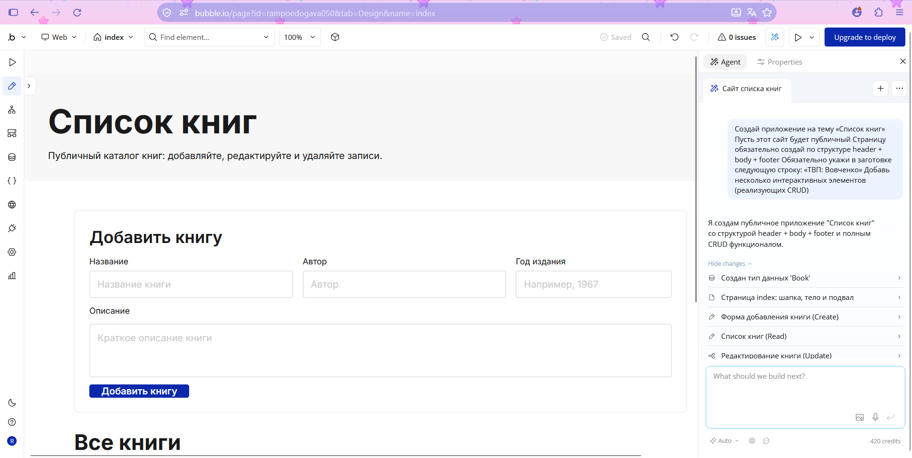

## 3. Ссылка на dev-версию

https://rampoedogava050.bubbleapps.io/version-test

## 4. Использованные AI-промпты (дословно)

### 4.1. Генерация каркаса приложения (Часть 1)

Тот же промпт, что в разделе 2.

### 4.2. Поиск идей для приложения (Часть 2)

```
У меня публичное приложение на Bubble «Список книг». Тип Book: title, author, description, year. Уже есть: форма добавления, Repeating Group со списком, кнопки «Редактировать» и «Удалить».

Предложи 5 простых идей, которых у меня нет (поиск, сортировка, счётчик и т.п.), которые можно сделать вручную без плагинов и API.

Для каждой: название, что видно «до» и «после», и 3-5 шагов реализации. От простой к сложной. Названия элементов Bubble оставляй на английском.
```

### 4.3. Новая сущность (Часть 4.1)

```
В моём приложении «Список книг» уже есть тип данных Book (title, author, description, year). Предложи новую сущность для этого приложения, отличную от Book, например отзывы, заметки о прочитанном или список желаемого.

Дай:
1. Название типа данных (на английском, в единственном числе)
2. 4-5 полей с названиями на английском и типами Bubble (text, number, date, yes/no и т.п.), минимум 3 разных типа
3. Одну строку о том, зачем нужно каждое поле
4. 3 примера записей, которые я смогу внести вручную

Сущность должна быть простой, чтобы на ней можно было сделать форму добавления, список, редактирование и удаление.
```

### 4.4. UI для CRUD новой сущности (Часть 4.2)

```
Создай новую страницу «notes» в моём приложении «Список книг». Страница нужна для работы с типом данных ReadingNote (поля: book — тип Book, date_read — дата, note_text — текст, rating — число, recommended — да/нет).

На странице должно быть:
1. Заголовок страницы «Мои заметки о прочитанном».
2. Форма добавления заметки: Dropdown для выбора книги (источник — все Book, показывать title), Date picker для date_read, Multiline Input для note_text, Input для rating (число), Checkbox для recommended, кнопка «Добавить заметку».
3. Repeating Group со списком всех ReadingNote. В каждой ячейке покажи: название книги, дату, текст заметки, оценку и отметку «рекомендую». В ячейке две кнопки: «Редактировать» и «Удалить».
4. Для редактирования сделай Popup или Group с теми же полями, что и в форме добавления, и кнопкой «Сохранить». По умолчанию он скрыт.

Дай элементам понятные имена на английском (например, Dropdown Book, Input Rating, Button Add, Button Edit, Button Delete, RG Notes). Добавь ссылку на страницу index.
```

## 5. Ход работы

### Часть 1. Промпт и генерация каркаса

(`01-prompt.png`).

### Часть 2. Исследование идеи

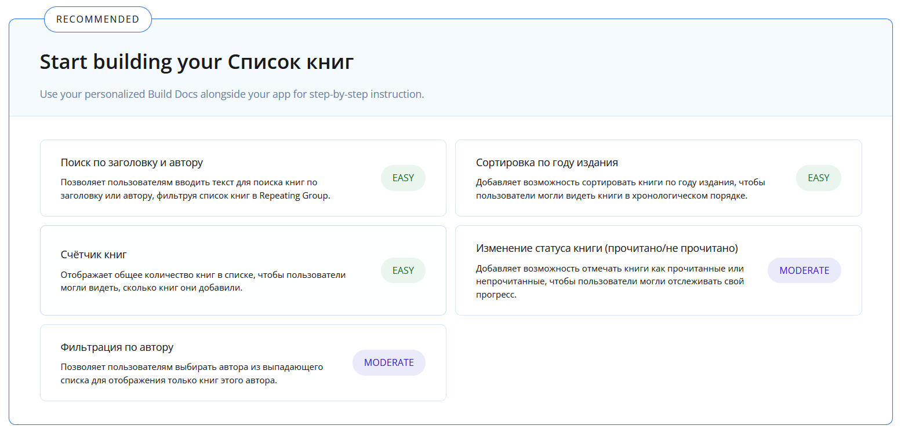

#### Основной гайд: «Счётчик книг»

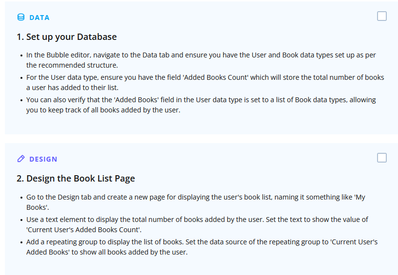
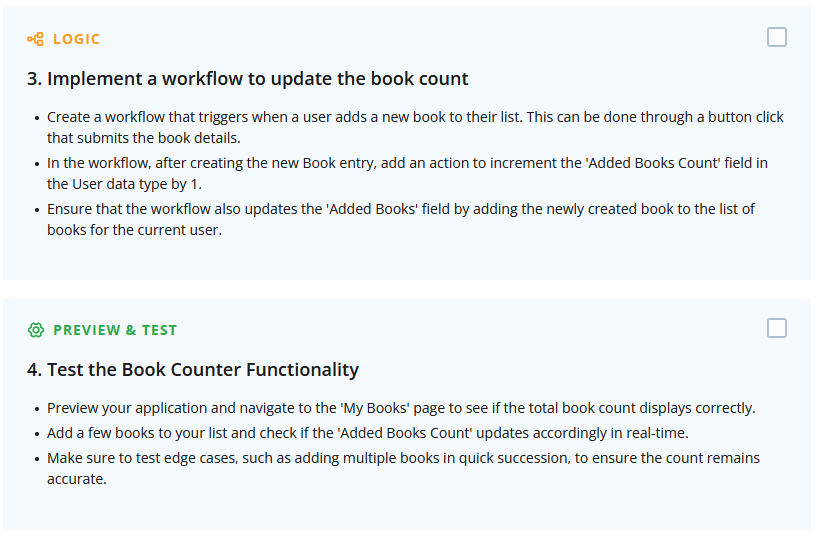

**Что посмотрела.** гайд из 4 шагов: подготовка базы данных, дизайн страницы с текстовым элементом и Repeating Group, workflow для обновления счётчика, тестирование в Preview.

**Что показалось полезным.** идея выводить над списком число записей, чтобы пользователь видел размер каталога.

**Что взяла в приложение.** счётчик «Всего книг: N». Реализовала проще, чем в гайде. Гайд хранит число в поле пользователя и увеличивает его в workflow при каждом добавлении книги. Но в моём приложении нет регистрации, а число можно получить прямо из базы. Поэтому в текстовом элементе использовано динамическое выражение `Do a search for Books:count` без ограничений. Число всегда соответствует базе, и отдельный workflow не нужен.

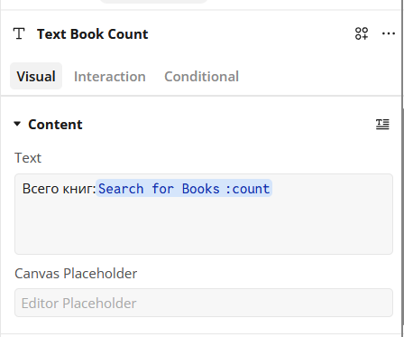

**До и после:**

| До | После |
|---|---|
| 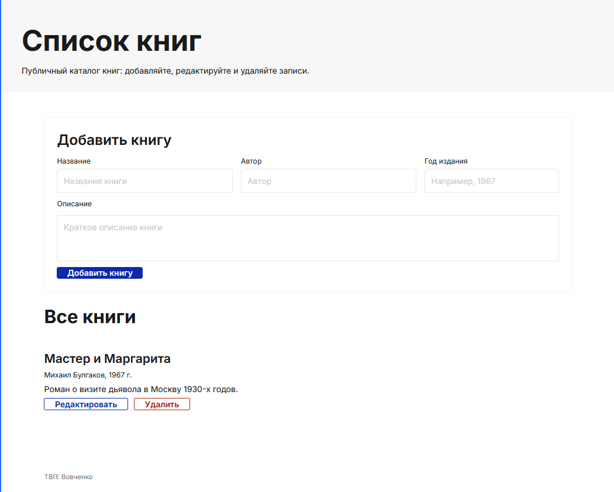 | 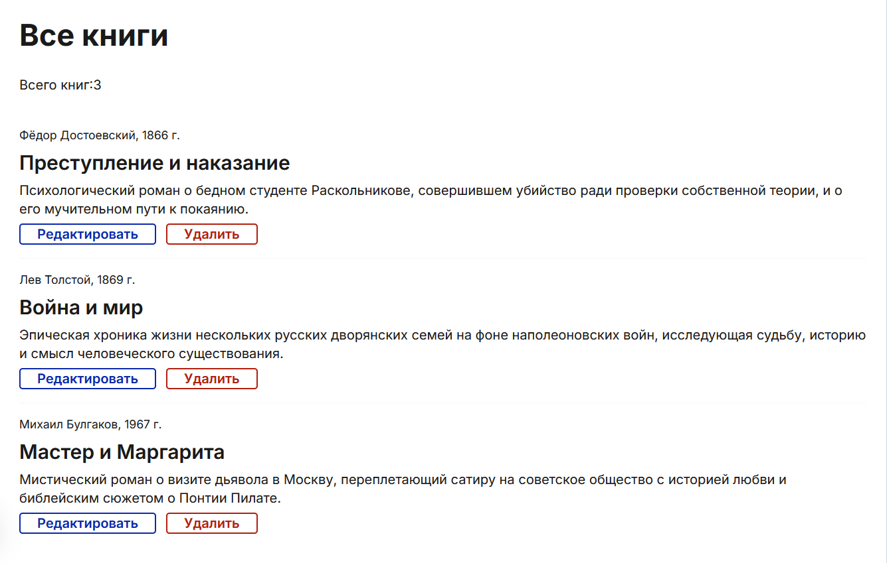 |

### Часть 3. Ручная доработка UI

#### 3.1. Заголовок

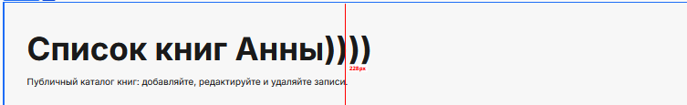

#### 3.2. Global variable для цвета

В Global → Variables создана цветовая переменная `yellow-color` (`#E4E277`, непрозрачность 100%). Я применила её к кнопкам: фон кнопки «Добавить книгу» берёт цвет из переменной.

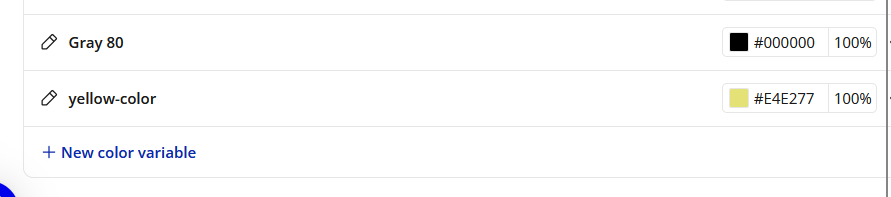
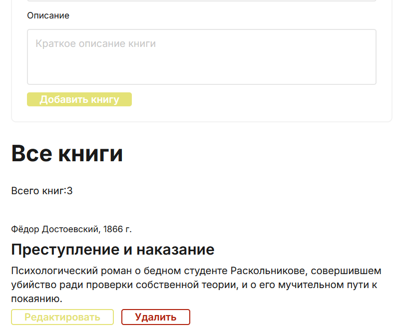

#### 3.3. Новый стиль

Создан стиль кнопки `yellow`, в котором цвет берётся из переменной `yellow-color`. Стиль применён к кнопкам «Добавить книгу» и «Редактировать». Если поменять переменную, цвет всех этих кнопок изменится сразу.

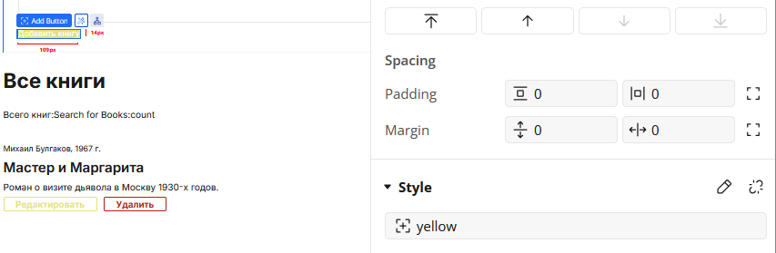

#### 3.4. Готовый компонент

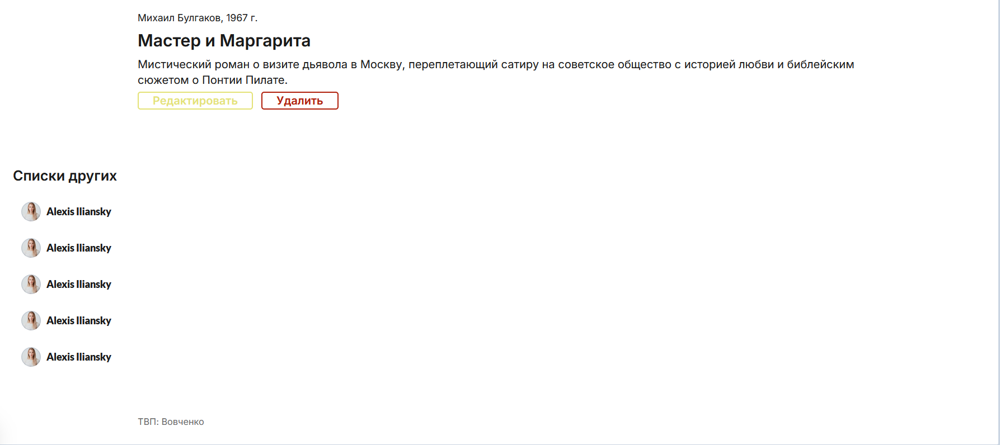

### Часть 4. Data и Workflows

#### 4.1. Новая сущность

Промпт из раздела 4.3 дал сущность **`ReadingNote`** (заметка о прочитанном). Я создала её вручную в Data → Data types.

| Поле | Тип | Назначение |
|---|---|---|
| `book` | Book | к какой книге относится заметка |
| `date_read` | date | дата прочтения |
| `note_text` | text | текст заметки |
| `rating` | number | оценка |
| `recommended` | yes / no | рекомендую ли книгу |

Кроме них у типа есть встроенные поля Bubble: Creator, Modified Date, Created Date, Slug.

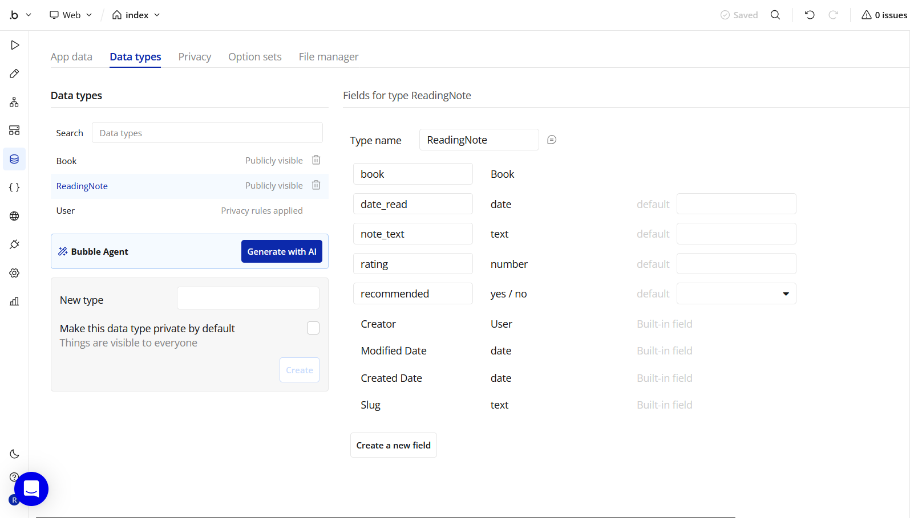

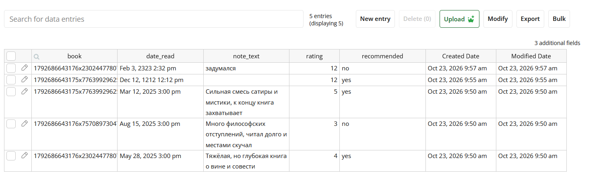

#### 4.2. CRUD на странице `notes`

Страницу `notes` с интерфейсом сгенерировал AI по промпту из раздела 4.4. 

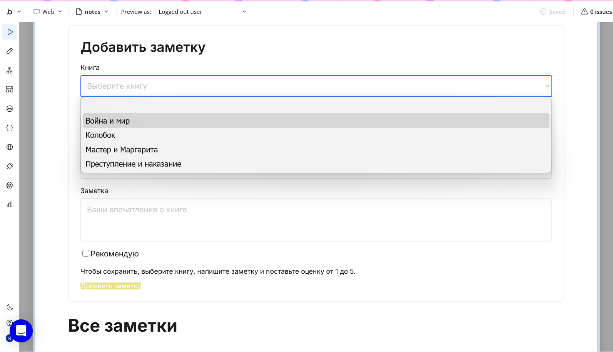

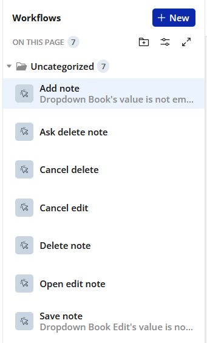

| Workflow | Операция | Триггер | Что делает |
|---|---|---|---|
| **Add note** | Create | клик по «Добавить заметку»; условие: значение `Dropdown Book` не пустое | Create a new thing: создаёт `ReadingNote`, поля (`book`, `date_read`, `note_text`, `rating`, `recommended`) берутся из элементов формы |
| *(список)* | Read | загрузка страницы | Repeating Group «Все заметки» с источником `Do a search for ReadingNotes`; отдельный workflow не нужен |
| **Open edit note** | Update, шаг 1 | клик «Редактировать» в ячейке | открывает форму редактирования и передаёт в неё выбранную заметку |
| **Save note** | Update, шаг 2 | клик «Сохранить»; условие: значение `Dropdown Book Edit` не пустое | Make changes to a thing: записывает значения из формы редактирования в выбранную заметку |
| **Cancel edit** | вспомогательный | клик «Отмена» в форме редактирования | закрывает форму без сохранения |
| **Ask delete note** | Delete, шаг 1 | клик «Удалить» в ячейке | Display data in `Popup Confirm Delete` (данные `Parent group's ReadingNote`), затем Show: открывает окно подтверждения |
| **Delete note** | Delete, шаг 2 | клик «Удалить» в окне подтверждения | Delete a thing: удаляет заметку, переданную в окно |
| **Cancel delete** | вспомогательный | клик «Отмена» в окне подтверждения | закрывает окно, запись остаётся |

**Delete:**

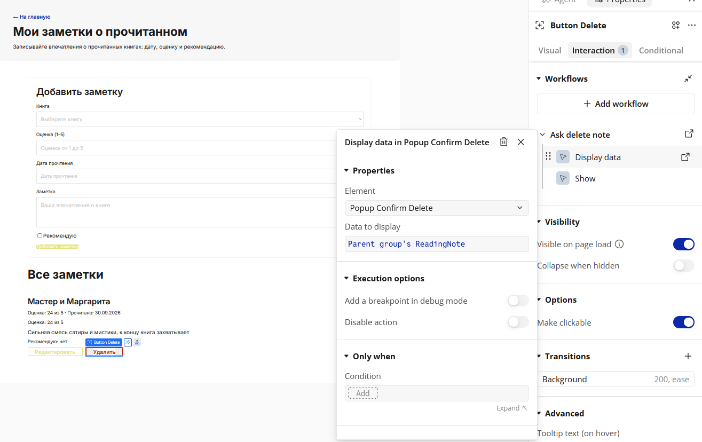
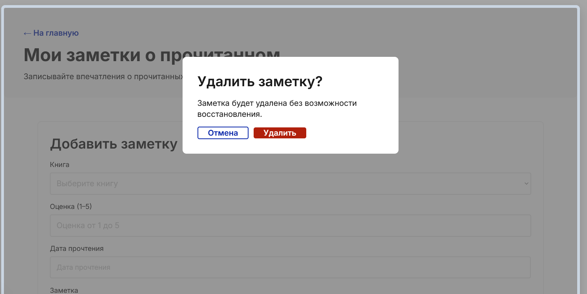

## 6. Какие элементы и workflows освоены

**Элементы Design:** Text, Input, Multiline Input, Dropdown, Date picker, Checkbox, Button, Repeating Group (ячейка `Cell`, источник данных), Popup, ссылка на другую страницу, готовый компонент из COMPONENTS.

**Global:** цветовая переменная, переиспользуемый стиль элемента.

**Data:** Data types и их поля (текст, число, дата, yes/no, связь с другим типом), App data, ручное добавление записей, динамические выражения `Do a search for … :count`.

**Workflows:** Create a new thing, Make changes to a thing, Delete a thing, Display data in popup, Show popup. Привязка workflow к клику по кнопке.

## 7. Выводы
В этой работе я научилась собирать приложение в Bubble: AI-агент создал каркас, а дальше я дорабатывала его сама. Я узнала как логика собирается из workflows и как Global variable и стили помогают менять оформление в одном месте.
