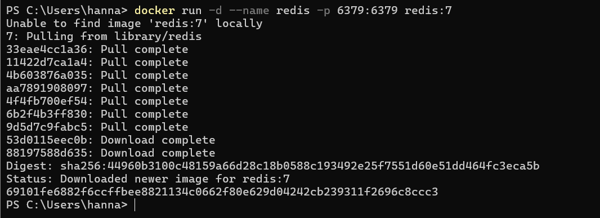
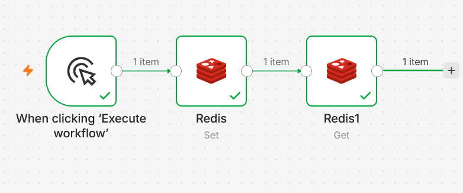
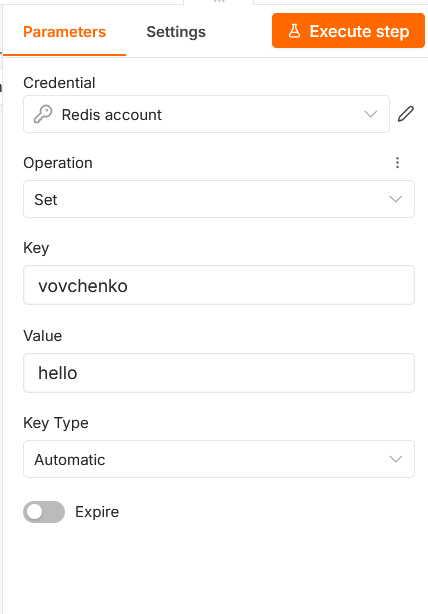
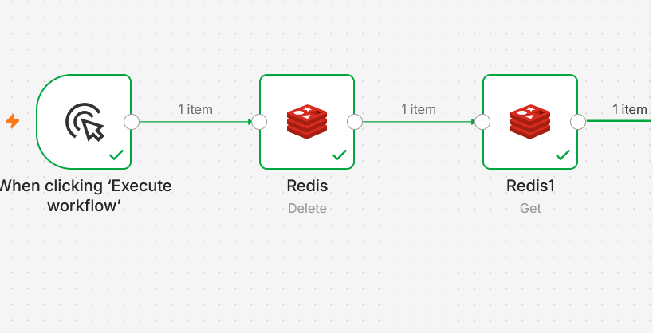
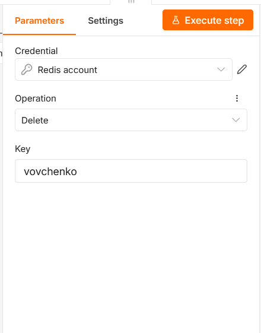
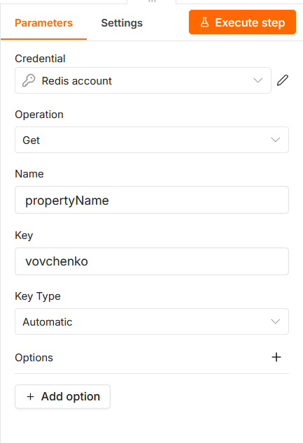

# Redis в n8n: создание и удаление ключа

Redis — база данных «ключ — значение», которая хранит данные в оперативной памяти и поэтому работает очень быстро. 
Redis запускается в Docker, подключается к n8n, и с его помощью создаётся, читается и удаляется ключ.

## 1. Запуск Redis в Docker

```powershell
docker run -d --name redis -p 6379:6379 redis:7
```

- `-d` — запуск в фоне;
- `--name redis` — имя контейнера;
- `-p 6379:6379` — стандартный порт Redis пробрасывается на хост;
- `redis:7` — образ Redis версии 7.

Образ скачался и контейнер запустился:




## 2. Credentials для Redis в n8n

В n8n создан credential **Redis account** со следующими параметрами:

| Поле | Значение |
|---|---|
| Host | `host.docker.internal` |
| Port | `6379` |
| User | пусто |
| Password | пусто |
| Database Number | `0` |

Адрес `host.docker.internal` нужен потому, что n8n работает внутри своего Docker-контейнера, и `localhost` для него означает сам контейнер n8n, 
а не компьютер, на котором Redis опубликовал порт 6379. Имя `host.docker.internal` указывает на хост-машину. Пароль не задаётся, так как Redis запущен без авторизации.

После сохранения n8n показывает сообщение «Connection tested successfully».

## 3. Workflow 1: создание и чтение ключа

Файл: `flows/flow-09-redis.json`

Цепочка: **Manual Trigger → Redis (Set) → Redis (Get)**



### Redis (Set) — создание ключа

| Параметр | Значение |
|---|---|
| Operation | Set |
| Key | `vovchenko` |
| Value | `hello` |
| Key Type | Automatic |
| Expire | выключен |



Нода записывает в Redis строку `hello` по ключу `vovchenko`. Так как Expire выключен, ключ не имеет срока жизни (TTL) и хранится, пока его не удалят.

### Redis (Get) — чтение значения

| Параметр | Значение |
|---|---|
| Operation | Get |
| Name | `propertyName` |
| Key | `vovchenko` |
| Key Type | Automatic |


Нода читает значение ключа `vovchenko` и кладёт его в поле `propertyName` выходных данных. Ожидаемый результат: `propertyName = "hello"`.

## 4. Workflow 2: удаление ключа и проверка

Файл: `flows/flow-10-redis.json`

Цепочка: **Manual Trigger → Redis (Delete) → Redis (Get)**



### Redis (Delete) — удаление ключа

| Параметр | Значение |
|---|---|
| Operation | Delete |
| Key | `vovchenko` |



Нода удаляет ключ `vovchenko` из Redis.

### Проверка отсутствия ключа



## 5. Итог

| Действие | Нода | Результат |
|---|---|---|
| Создание ключа | Redis (Set) | ключ `vovchenko` со значением `hello` |
| Чтение значения | Redis (Get) | возвращено `hello` |
| Удаление | Redis (Delete) | ключ `vovchenko` удалён |
| Проверка отсутствия | Redis (Get) | значение пустое, ключа больше нет |
