# Отчет по лабораторной работе №4
**Тема:** n8n
**Студент:** Вовченко Анна   
**Группа:** Уир241  

---

## 1. Способ установки и запуск n8n

* **Способ установки:** Docker с использованием официального образа `n8nio/n8n`.
* **Параметры запуска:**
  * Проброс порта: `5678:5678`
  * Монтирование объемов (`volumes`):
    * Локальная папка `n8n_data` → `/home/node/.n8n` (для хранения конфигурации и системных данных n8n)
    * Локальная папка `n8n_storage` → `/data` (для хранения пользовательских файлов и данных)
  * Команда запуска:
    ```bash
    docker run -d \
      --name n8n \
      -p 5678:5678 \
      -v n8n_data:/home/node/.n8n \
      -v n8n_storage:/data \
      n8nio/n8n
    ```
* **Версия n8n:** v1.x (официальный Docker image `n8nio/n8n`)
* **Адрес сервиса:** `http://localhost:5678`  
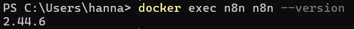
---

## 2. Краткое описание выполненной работы

В ходе лабораторной работы были освоены ключевые возможности low-code платформы автоматизации **n8n**:

1. **Базовые ноды и сценарии:**
   * **Manual Trigger → Set → Code:** создан поток с первичной инициализацией payload (`lab4/Vovchenko/basic`) и выводом данных в консоль/результат.
   * **Code node (JS Logic):** написан сценарий на JavaScript с использованием `const`/`let`, циклов `for`, условных операторов `if/else`, массивов и объектов.
   * **IF node (Ветвление):** настроено условное ветвление данных на ветки `True` и `False` (NoOp) на основе анализа payload.
   * **Set node (Трансформация):** реализована модификация структуры данных, добавление метки времени (`timestamp`) и темы (`topic`).
   * **HTTP Request node:** настроено получение внешних данных по протоколу HTTP (GET-запрос к публичному API с JSON-ответом).
   * **Schedule Trigger:** настроен периодический автоматический запуск сценария по расписанию (раз в 1/5 минут).

2. **Интеграция с Redis:**
   * Запущен Docker-контейнер Redis (`redis:7` на порту 6379).
   * В n8n настроены учетные данные (`Credentials`) для подключения к Redis через `host.docker.internal:6379`.
   * **Flow 1 (Set / Get):** автоматизировано создание ключа `vovchenko` со значением и последующее чтение данных.
   * **Flow 2 (Delete / Exists):** реализовано удаление ключа и проверка его отсутствия.
   * Отчет по работе с Redis оформлен в `lab4/docs/redis.md`.

---

## 3. Примеры использованных AI-промптов

В процессе разработки и настройки сценариев n8n использовались следующие промпты для генерации JavaScript-кода и конфигурации нод:

### 1️ Промпт: Логика обработки массива в Code node (Задание 2.2 / 2.3)
> **Промпт:** *"Напиши JS-код для ноды Code в n8n, который принимает входные данные, использует const/let, цикл for по массиву, проверку if/else и возвращает массив объектов n8n в формате [{ json: { payload: ... } }]."*

```javascript
// Код для Code Node (n8n format)
const items = [120, 450, 300, 80];
let totalSum = 0;

for (let i = 0; i < items.length; i++) {
    totalSum += items[i];
}

let status = totalSum > 500 ? "APPROVED" : "REJECTED";

return [
  {
    json: {
      surname: "Vovchenko",
      group: "BIV201",
      totalSum: totalSum,
      status: status,
      payload: "lab4/vovchenko/processed"
    }
  }
];
```


---

### 2 Промпт: Работа с текущей датой и временем в Schedule Trigger (Задание 2.6)
> **Промпт:** *"Напиши функцию для n8n Code Node, которая возвращает текущее время в формате ISO и читаемый timestamp для логирования запуска по расписанию."*

```javascript
const now = new Date();

return [
  {
    json: {
      executedAt: now.toISOString(),
      formattedTime: now.toLocaleTimeString('ru-RU'),
      triggeredBy: "Schedule Trigger",
      status: "Running"
    }
  }
];
```

---

### 3 Промпт: Проверка удаления ключа Redis (Часть 3)
> **Промпт:** *"Напиши сценарий обработки ответа от Redis Exists ноды в n8n, чтобы вернуть понятный статус: существует ключ или нет."*

```javascript
const existsStatus = $input.first().json.result; // 0 or 1

return [
  {
    json: {
      key: "vovchenko",
      isDeleted: existsStatus === 0,
      message: existsStatus === 0 ? "Ключ успешно удален" : "Ошибка: ключ все еще существует"
    }
  }
];
```

---

## 4. Освоенные ноды n8n

* **Триггеры (Triggers):**
  * `Manual Trigger` — ручной запуск цепочки.
  * `Schedule Trigger` — запуск сценариев по расписанию (Cron / интервалы).
* **Логика и Данные (Core Nodes):**
  * `Code` — выполнение произвольного кода на JavaScript (Node.js) для сложной обработки данных.
  * `Set` (Edit Fields) — создание, переименование и трансформация полей элементов.
  * `IF` — условная фильтрация и ветвление потока данных по правилам.
  * `NoOp` (No Operation) — нода-заглушка для наглядного завершения веток.
* **Сетевые и Интеграции:**
  * `HTTP Request` — выполнение внешних REST API запросов (GET/POST) с авто-парсингом JSON.
  * `Redis` — нода взаимодействия с K/V хранилищем Redis (операции Set, Get, Delete, Exists).

---

## 5. Скриншоты разработанных workflow

Все скриншоты сохранены в директории `lab4/screenshots/`:

### 2.1. Manual Trigger → Set → Code
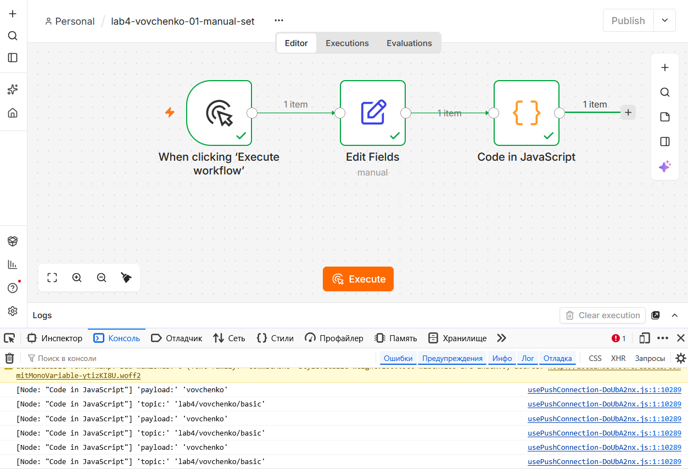

### 2.2. Code Node Logic
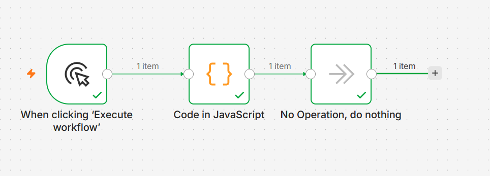
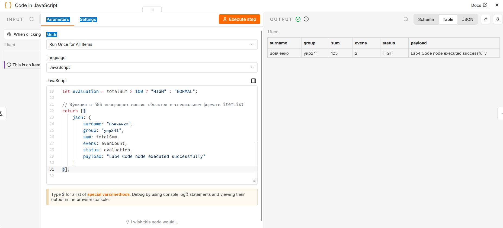

### 2.3. IF Node (Ветвление)
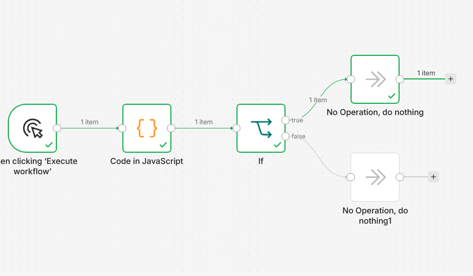
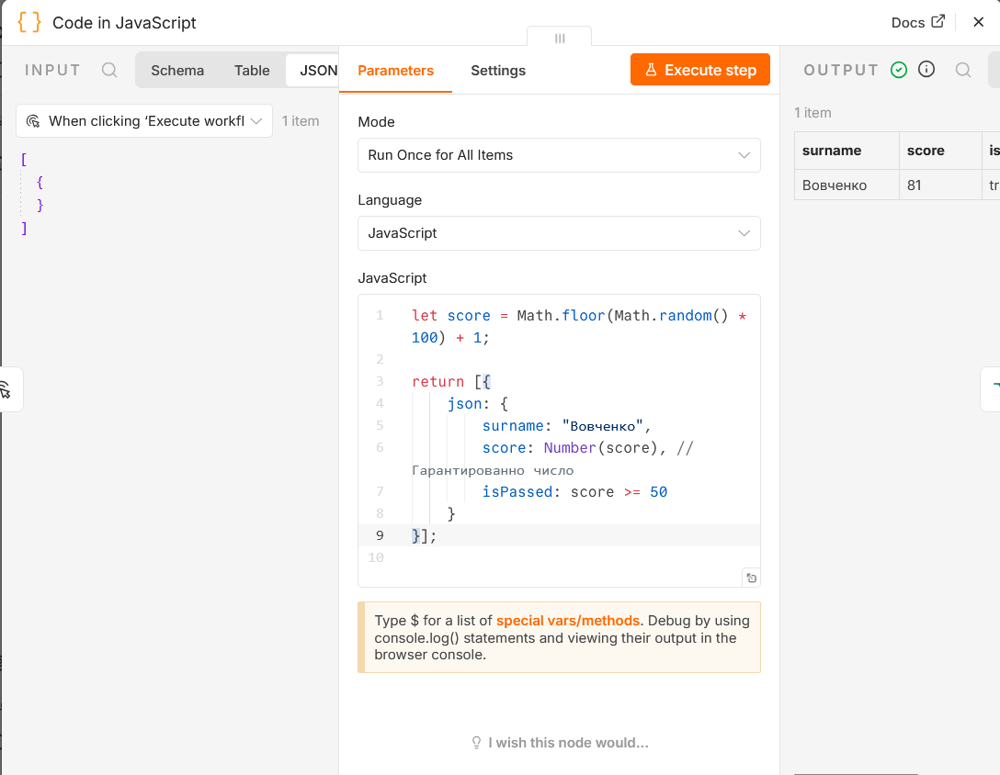

### 2.4. Set Node (Модификация полей)
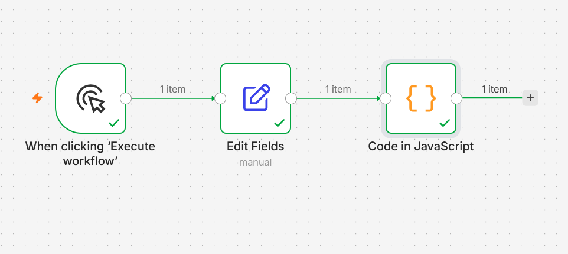
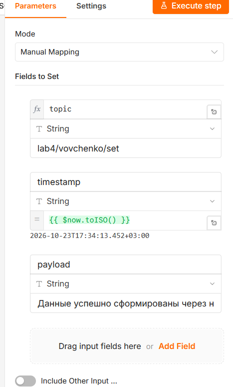
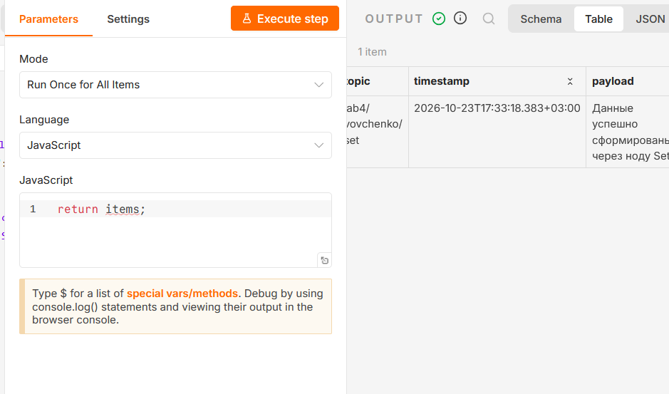

### 2.5. HTTP Request Node (Публичный API)
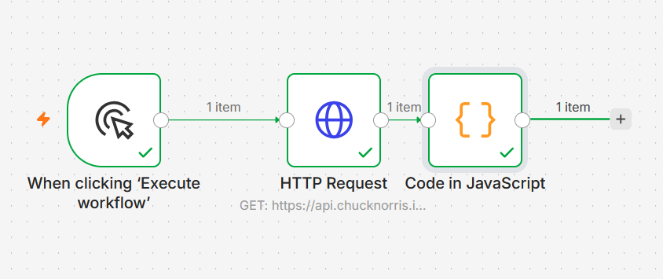
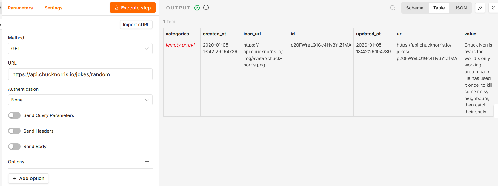
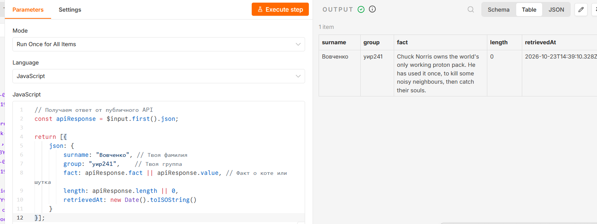

### 2.6. Schedule Trigger (Запуск по расписанию)
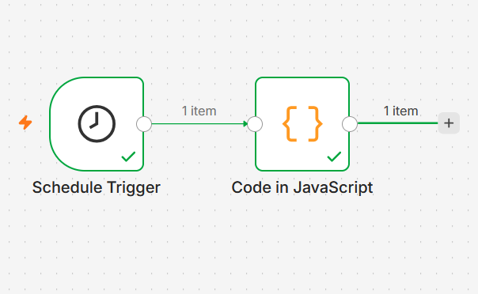
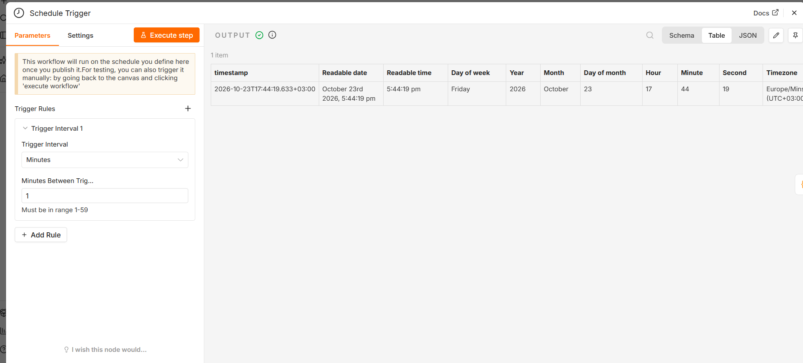
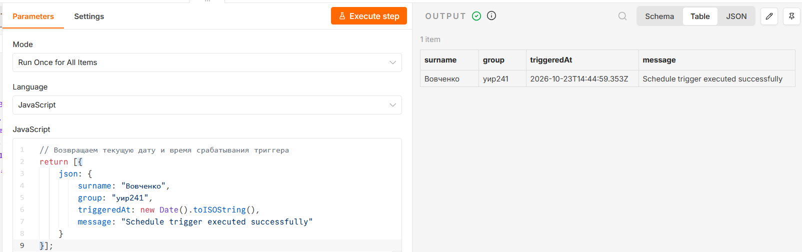

### 3. Redis


---

## 6. Выводы
Научилась пользоваться n8n как low-code платформой, прошла базовый цикл работы с Redis из n8n.
