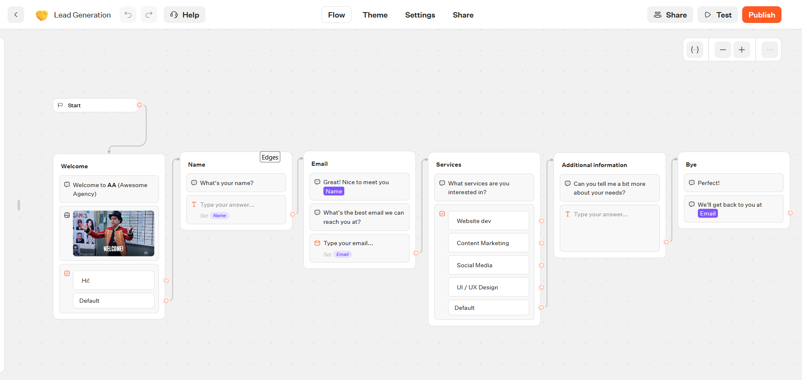
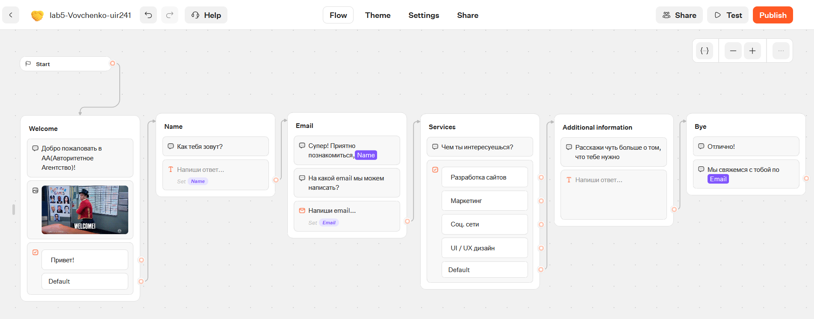
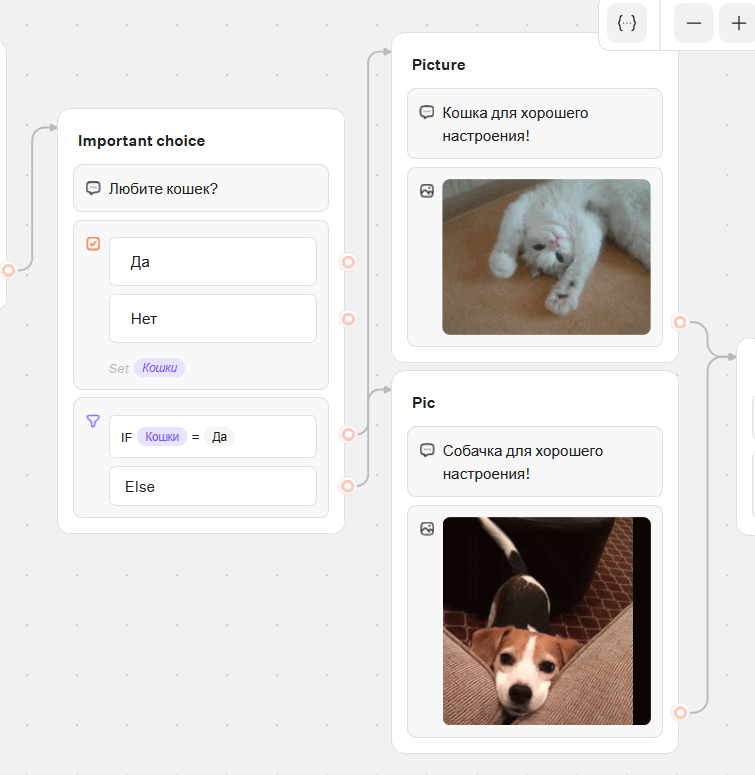
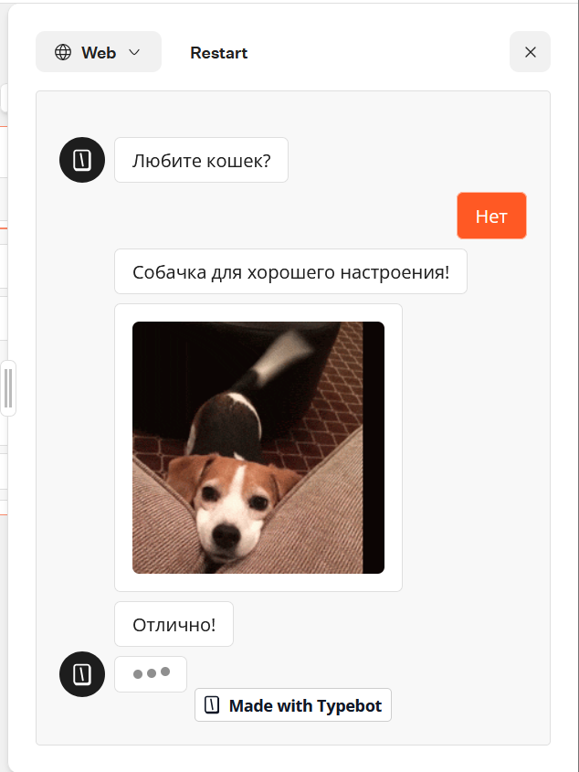
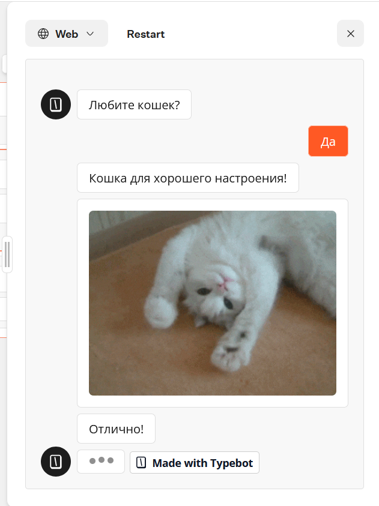
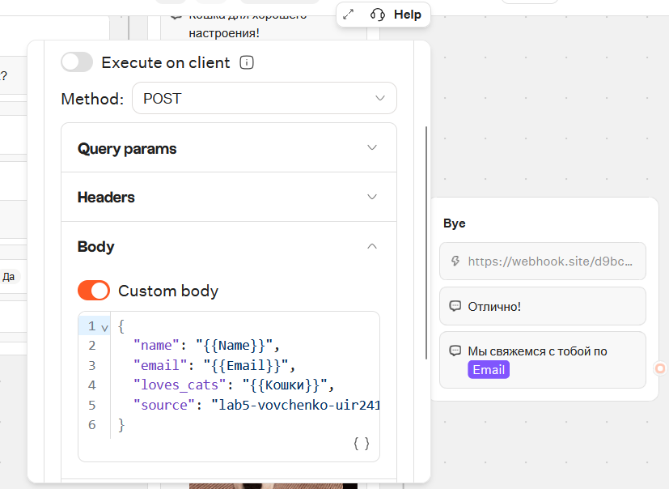
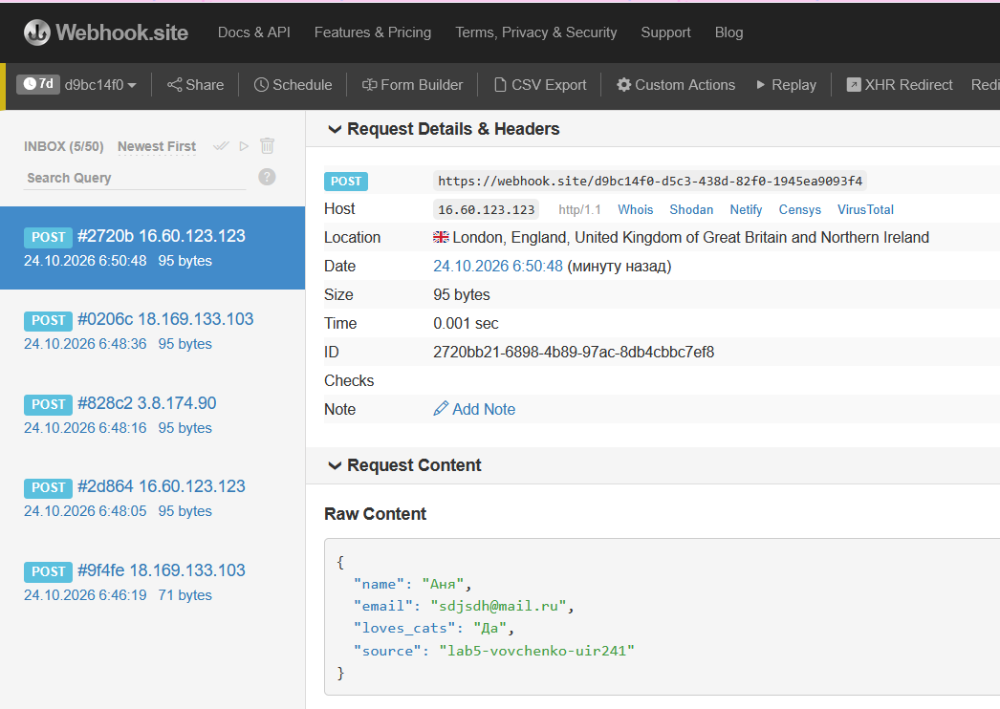
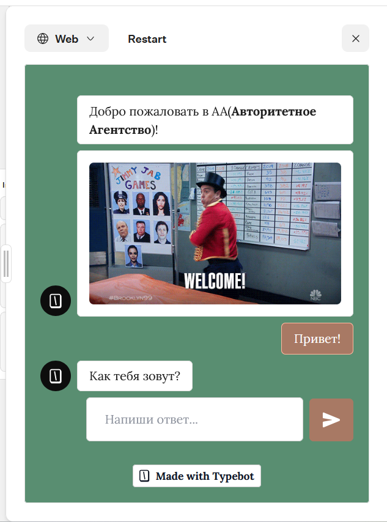
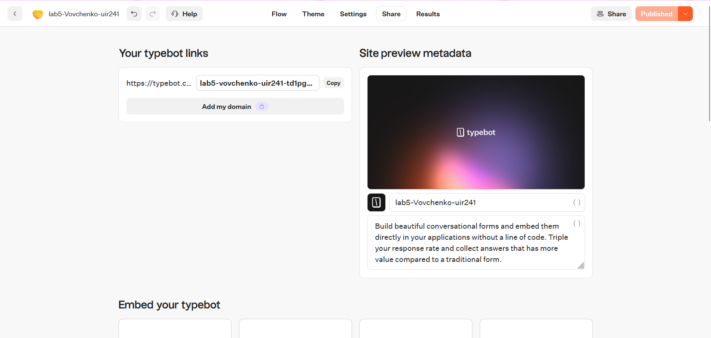
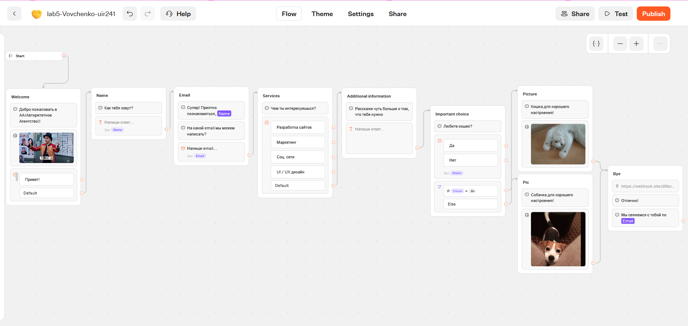

# Лабораторная работа №5. Чат-боты

**Студент:** Вовченко, группа УИР-241
**Трек:** C — TypeBot
---

## 1. Краткое описание выбранного трека

Я выбрала трек C (TypeBot) и работала в TypeBot Cloud (typebot.co). В качестве основы взяла готовый шаблон **Lead Generation** из раздела Templates. 
Это бот для сбора заявок: он здоровается, спрашивает имя и email, предлагает выбрать услугу и просит рассказать подробнее о задаче.

Что сделано:

1. Зарегистрировалась в TypeBot Cloud, создала workspace и бота `lab5-Vovchenko-uir241` из шаблона Lead Generation.
2. Полностью русифицировала шаблон: приветствие, вопросы, кнопки, плейсхолдеры («Напиши ответ…», «Напиши email…») и прощание. Переменные `Name` и `Email` в тексте сообщений продолжили работать.
3. Добавила новую ветку диалога «Любите кошек?» с переменной `Кошки` и блоком **Condition**: на «Да» бот показывает кошку, на «Нет» — собаку.
4. Добавила блок **HTTP request** (POST), который в конце диалога отправляет данные пользователя на внешний адрес (webhook.site).
5. Сменила тему оформления: цвета, шрифт, оформление кнопок и бабблов.
6. Опубликовала бота по публичной ссылке и экспортировала flow в JSON.

---

## 2. Ссылка на бота

**Публичная ссылка:** https://typebot.co/lab5-vovchenko-uir241-td1pg4s

**Экспорт flow:** `lab5/exports/flow-01-lab5-vovchenko-uir241.json`

---

## 3. Использованные AI-промпты

Я использовала Claude как помощника по выполнению лабы. Ключевые запросы:
"Объясни как добавить интеграцию, HTTP Request или Webhook"
## 4. Освоенные блоки, ноды и элементы

| Элемент | Где используется |
|---|---|
| **Text bubble** | Приветствие, вопросы («Как тебя зовут?», «Любите кошек?»), прощание |
| **Image bubble** | GIF в приветствии, картинки кошки и собаки |
| **Buttons input** | Выбор «Привет!», выбор услуги, ответ «Да» / «Нет» |
| **Text input** | Ввод имени, дополнительная информация |
| **Email input** | Ввод email с проверкой формата |
| **Variable** (переменные) | `Name`, `Email`, `Кошки`; использование в тексте как `{{Name}}`, `{{Email}}` |
| **Condition** | `IF Кошки = Да` → группа «Picture», иначе (Else) → группа «Pic» |
| **Groups и edges** (группы и связи) | Построение сценария из групп и ветвление |
| **HTTP request** (Integrations) | POST-запрос на webhook.site с JSON-телом из переменных |
| **Theme** | Цвета, шрифт, оформление чата |
| **Test** | Прогон сценария в окне предпросмотра |
| **Publish / Share** | Публикация и получение публичной ссылки |
| **Export** | Экспорт flow в JSON |

### Настройка переменных

В боте используются три переменные:

- `Name` — сохраняется ответом в блоке «Как тебя зовут?»;
- `Email` — сохраняется ответом в email-блоке;
- `Кошки` — сохраняется ответом на вопрос «Любите кошек?» (значение «Да» или «Нет»).

Переменная `Кошки` используется в блоке Condition. Все три переменные передаются в HTTP request.

### Условие (Condition)

`IF Кошки = Да` → ветка «Picture» (кошка). Во всех остальных случаях (Else) → ветка «Pic» (собака). После обеих веток бот переходит в группу «Bye».

### HTTP request

Группа **Bye** начинается с блока HTTP request:

- метод: `POST`;
- URL: уникальный адрес на webhook.site;
- Custom body:

```json
{
  "name": "{{Name}}",
  "email": "{{Email}}",
  "loves_cats": "{{Кошки}}",
  "source": "lab5-vovchenko-uir241"
}
```

---

## 5. Скриншоты

### 5.1. «До»: исходный шаблон Lead Generation

Оригинальный шаблон на английском языке.



### 5.2. «После» русификации

Все тексты, кнопки и плейсхолдеры переведены. Переменные `Name` и `Email` в сообщениях работают.



### 5.3. Переменная и условие (Condition)

Группа «Important choice»: кнопки «Да» / «Нет» сохраняются в переменную `Кошки`, блок Condition проверяет `Кошки = Да`. Выход If ведёт в «Picture», Else — в «Pic».



### 5.4. Результат: диалог, ветка «Нет»



### 5.5. Результат: диалог, ветка «Да»



### 5.6. Настройки HTTP request

Метод POST, Custom body с переменными.



### 5.7. Запрос, принятый на webhook.site

Сервер получил POST с реальными данными из диалога: имя, email, ответ про кошек и поле `source`. В списке слева видно несколько запросов (тестовые и полный прогон бота).



### 5.8. Новая тема оформления

Изменены цвет фона, цвета кнопок и бабблов, шрифт.



### 5.9. Публикация

Бот опубликован (статус «Published»), публичная ссылка в разделе Share.



### 5.10. «После»: итоговый flow

Итоговая схема. Цепочка шаблона (Welcome → Name → Email → Services → Additional information) дополнена группой «Important choice» с условием, ветками «Picture» / «Pic» и финальной группой «Bye» с HTTP request.



---

## 8. Выводы
Поняла принцип создания и освоила построение бота с помощью TypeBot Cloud (typebot.co)
