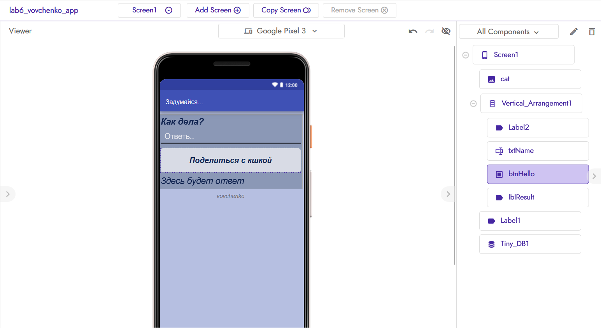
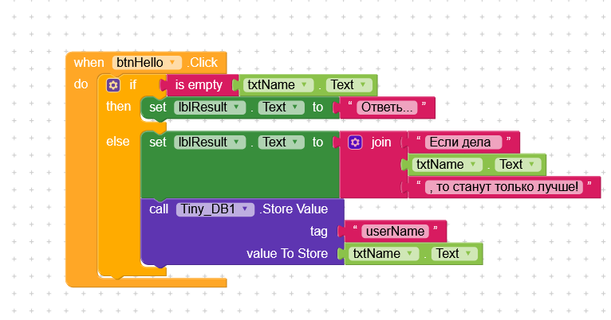
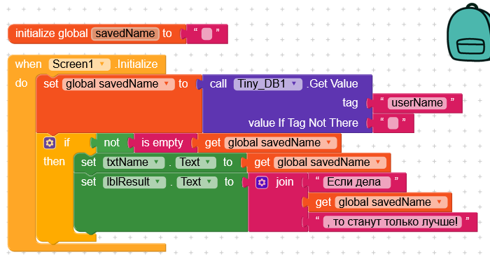

# Лабораторная работа №6. Kodular

## Описание приложения
Приложение спрашивает, как у пользователя дела. Пользователь пишет ответ, нажимает кнопку, а приложение в ответ говорит приятные слова.

## Базовая часть
Компоненты: Label, TextBox (Hint), Button, Label результата.
Блоки: when Click, if/else, is empty, join, set Text.

## Ачивка 1: TinyDB
Компоненты: Tiny_DB1, txtName, lblResult.
Блоки: Screen1.Initialize, GetValue, StoreValue, глобальная переменная,
if/else, not, is empty, join.
Ответ сохраняется кнопкой и подставляется при следующем запуске.

## Файл проекта
exports/lab6_vovchenko_app.aia

## AI-промпты
Какие компоненты Kodular нужны для сохранения данных между запусками приложения? Приведи пример с TinyDB.  

## Освоенные компоненты и блоки
Label, TextBox, Button, TinyDB; if/else, join, is empty, not, переменные.

## Ограничения бесплатного тарифа
До 10 проектов, 10 МБ ассетов, 5 расширений; монетизация недоступна.

## Выводы
Научилась делать простые приложения в Kodular. Удобный инструмент :)
