# Лабораторная работа №7. Notion

**Автор:** Vovchenko Anna  
**Тема:** «Питомник редких хищных растений»  
**Опубликованная страница:** <https://prickle-eye-c80.notion.site/lab7-vovchenko-notion-40f70521c86c80e89cc7c3f1d5b02392?source=copy_link>  

---

## 1. Предметная область и модель данных

Я выбрала предметную область «Питомник редких хищных растений». Питомник выращивает и продаёт венерины мухоловки, росянки, непентесы и саррацении. Для работы нужно знать, какие растения есть, где они стоят (у разных видов разные требования к влажности и свету), кто за ними отвечает и когда проводились подкормки, поливы и обработки от вредителей.

Модель состоит из четырёх сущностей, центральная из них — растения:

| База | Назначение |
|---|---|
| Plants-vovchenko | Растения: вид, статус, дата посадки, цена |
| Locations-vovchenko | Локации: теплицы, полки, террариумы с параметрами климата |
| Keepers-vovchenko | Сотрудники-ботаники и их специализация |
| Feedings-vovchenko | Журнал подкормок, поливов и обработок |

### Формулы и кнопка

**Возраст (дней)** (Plants). Считается только для растущих растений, у проданных и погибших показывается прочерк:

```
if(prop("Статус") == "Растёт", dateBetween(now(), prop("Дата посадки"), "days"), "—")
```

**Просрочено** (Feedings). Если срок следующей обработки уже прошёл, запись помечается предупреждением:

```
if(empty(prop("Следующая обработка")), "—", if(dateBetween(now(), prop("Следующая обработка"), "days") > 0, "⚠️ Просрочено", "OK"))
```

**Кнопка «Отметить проданным»** (Plants). Действие Edit property: свойство «Статус» получает значение «Продано».

---

## 2. Промпт для ИИ, ответ ИИ и что исправлено

### Промпт

> Придумай уникальную предметную область для учебного проекта в Notion (не банальную вроде библиотеки или задач). Нужно 3–4 связанные сущности, минимум 2 связи Relation, у каждой сущности не менее 3 свойств. Используй типы: Title, Select/Multi-select, Date, Number, Relation, Formula. Добавь одну формулу и одну кнопку (Button). Опиши модель данных и объясни, зачем нужна каждая связь.

### Ответ ИИ (первая версия)

<details>
<summary>Развернуть исходный ответ ИИ</summary>

**Предметная область: «Питомник редких хищных растений».** Есть растения, условия содержания (локации), сотрудники-ботаники и журнал подкормок/обработок.

**1. Plants — Растения (центральная таблица)**

| Свойство | Тип | Значения / пояснение |
|---|---|---|
| Название | Title | «Dionaea muscipula 'B52'» |
| Вид | Select | Венерина мухоловка / Росянка / Непентес / Саррацения |
| Статус | Select | Растёт / На карантине / Продано / Погибло |
| Дата посадки | Date | когда высажено |
| Цена (€) | Number | для продажи |
| Возраст (дней) | Formula | `dateBetween(now(), prop("Дата посадки"), "days")` |
| Локация | Relation → Locations | где стоит (many-to-one) |
| Куратор | Relation → Keepers | кто отвечает (many-to-one) |
| Журнал | Relation → Feedings | все подкормки (обратная) |

**2. Locations — Локации (теплицы/зоны)**

| Свойство | Тип |
|---|---|
| Название | Title |
| Тип климата | Select (Тропический / Умеренный / Засушливый) |
| Влажность (%) | Number |
| Освещение (люкс) | Number |
| Растения | Relation → Plants (обратная) |

**3. Keepers — Сотрудники-ботаники**

| Свойство | Тип |
|---|---|
| Имя | Title |
| Специализация | Multi-select (Хищные / Орхидеи / Суккуленты) |
| Стаж (лет) | Number |
| Растения | Relation → Plants (обратная) |
| Смены | Relation → Feedings (обратная) |

**4. Feedings — Журнал подкормок и обработок**

| Свойство | Тип | Пояснение |
|---|---|---|
| Запись | Title | «Подкормка №184» |
| Тип операции | Select | Кормление / Полив / Обработка от вредителей |
| Дата | Date | когда проведено |
| Дозировка (мл) | Number | объём раствора/корма |
| Растение | Relation → Plants | кого обрабатывали (many-to-one) |
| Исполнитель | Relation → Keepers | кто проводил (many-to-one) |
| Просрочено | Formula | `if(dateBetween(now(), prop("Дата"), "days") > 30, "⚠️ Давно", "OK")` |
| Кнопка «Повторить» | Button | создаёт новую запись в Feedings с сегодняшней датой, копируя Растение и Тип операции |

**Связи (Relations)**

1. Plants ↔ Locations (много растений → одна локация): группировка растений по микроклимату, контроль заполненности теплицы.
2. Plants ↔ Keepers (много растений → один куратор): распределение нагрузки между сотрудниками.
3. Feedings ↔ Plants (много записей → одно растение): история ухода по каждому растению, основа для формулы «Просрочено».
4. Feedings ↔ Keepers (много записей → один исполнитель): отчёт по активности сотрудников и контроль качества обработок.

**Зачем формулы и кнопка**

- Formula «Возраст (дней)» считается сама, нужна для сортировки и планирования продаж и пересадок.
- Formula «Просрочено» подсвечивает записи, которых давно не касались.
- Button «Повторить» одним кликом создаёт повторную запись в журнале.

</details>

### Что я исправила после проверки

1. **Формула «Просрочено» не соответствовала своему описанию.** ИИ заявил проверку «по дате последней операции», но формула сравнивала дату самой записи. Любая запись старше 30 дней всегда оказывалась бы «просроченной», и это бессмысленно. Я добавила в Feedings свойство **«Следующая обработка» (Date)** и переписала формулу так, чтобы она сравнивала срок следующей обработки с текущей датой.
2. **Кнопка «Повторить» была слишком сложной для базовой части.** Задание требует кнопку с простым действием, а создание новой записи с копированием значений ненадёжно настраивается. Я заменила её на кнопку «Отметить проданным» в Plants, которая меняет статус растения.
3. **ИИ неверно написал про many-to-many.** Он сказал, что для такой связи нужна промежуточная таблица, но в Notion Relation по умолчанию допускает несколько связанных страниц. Я осознанно включила ограничение **Limit 1 page** там, где связь по смыслу должна быть «много к одному» (локация, куратор, растение, исполнитель в записи журнала).
4. **Переименовала связь «Смены» в «Проведённые операции»,** потому что эта связь ведёт к операциям журнала, а не к сменам.
5. **Улучшила формулу возраста.** В исходном варианте возраст продолжал бы расти у проданных и погибших растений. Теперь он считается только для статуса «Растёт», иначе показывается прочерк.
6. **Добавила фамилию в названия баз и главной страницы,** как требует задание.
7. **Уточнила, что «Локации» — это зоны и полки питомника** (например, «Теплица A, полка 1», «Террариум 3»), чтобы реалистично набрать минимум 10 записей.

---

## 3. Ссылка на опубликованную страницу

<https://prickle-eye-c80.notion.site/lab7-vovchenko-notion-40f70521c86c80e89cc7c3f1d5b02392?source=copy_link>

---

## 4. Освоенные компоненты и настройки Notion

- Создание страниц и inline-баз данных (Database – Inline), оформление страницы заголовками.
- Свойства баз: Title, Select, Multi-select, Date, Number, Relation, Formula, Button.
- Настройка вариантов для Select и Multi-select.
- Relation: выбор связанной базы, Two-way relation (обратные колонки), ограничение Limit 1 page, переименование обратных колонок.
- Formula: функции `prop`, `if`, `empty`, `now`, `dateBetween`, сравнение строк и чисел.
- Button: действие Edit property для изменения свойства текущей записи.
- Представления: Table, Board (канбан с группировкой по свойству «Статус»), Calendar (по свойству «Дата»); переименование представлений, настройка группировки и видимости свойств.
- Заполнение баз связанными данными и проверка работы обратных связей.
- Публикация страницы в веб (Share → Publish to web).

---

## 7. Скриншоты

### Главная страница с фамилией

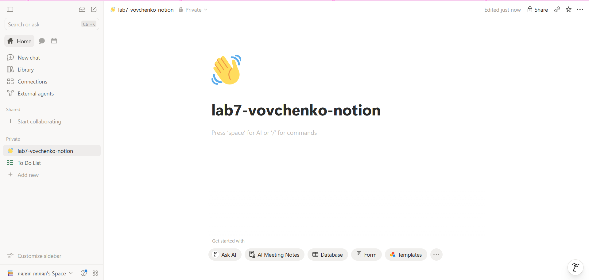

### Базы данных

Четыре базы на главной странице:

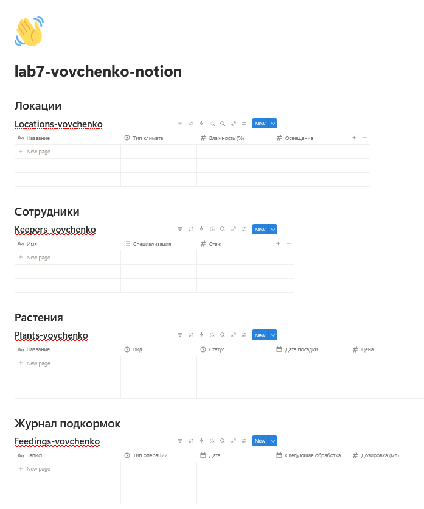

Связи между базами (колонки Relation и обратные колонки):

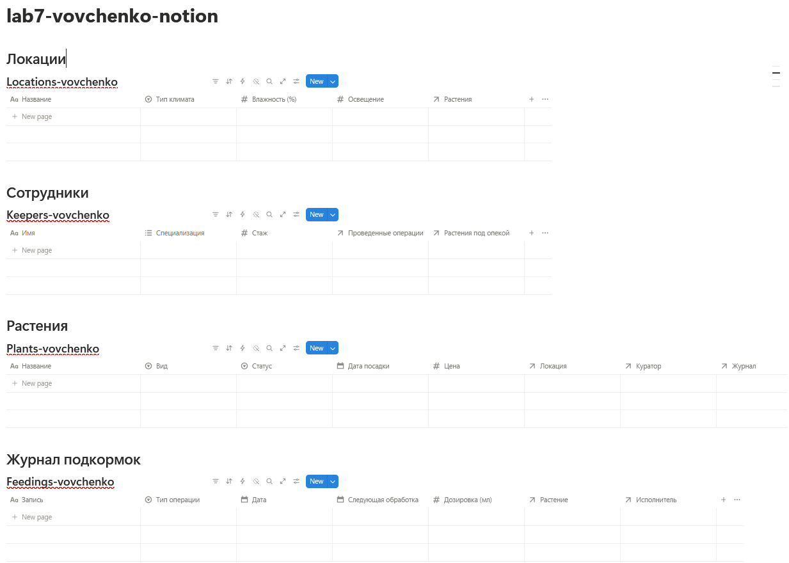

### Наполненные базы

Locations (10 записей):

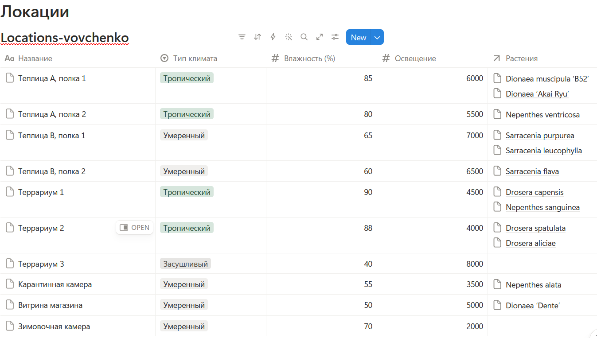

Keepers (10 записей):

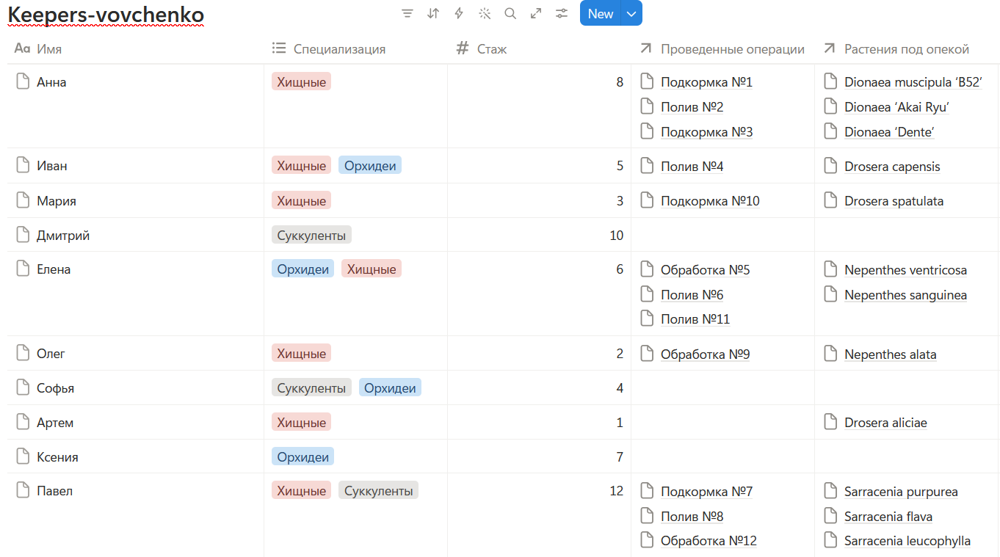

Plants (12 записей):

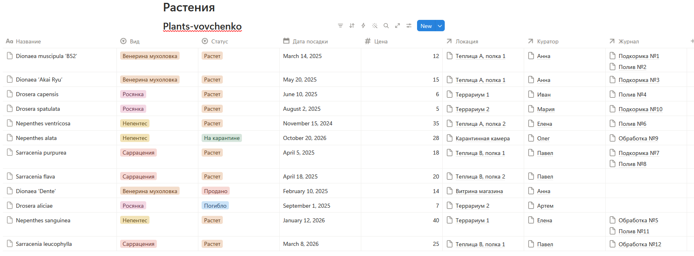

Feedings (12 записей):

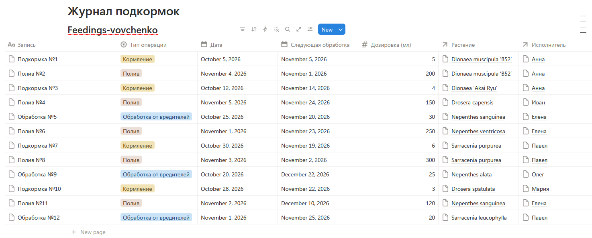

### Формулы

Формула «Возраст (дней)» в Plants:

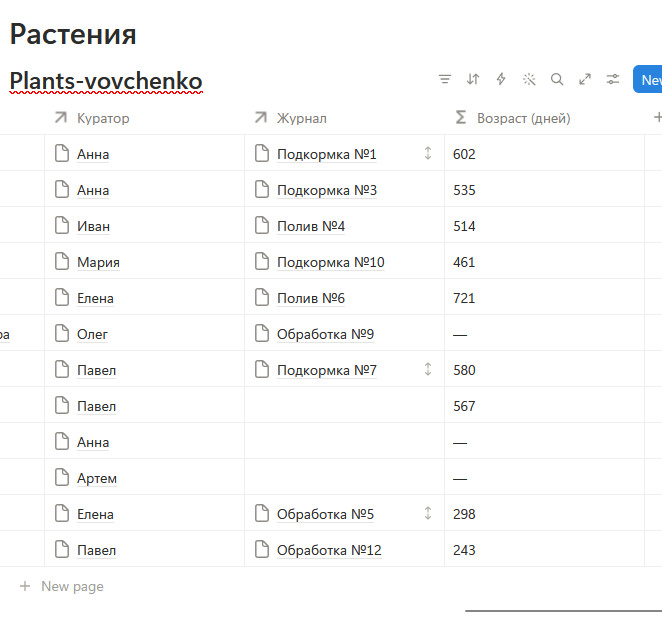

Формула «Просрочено» в Feedings:

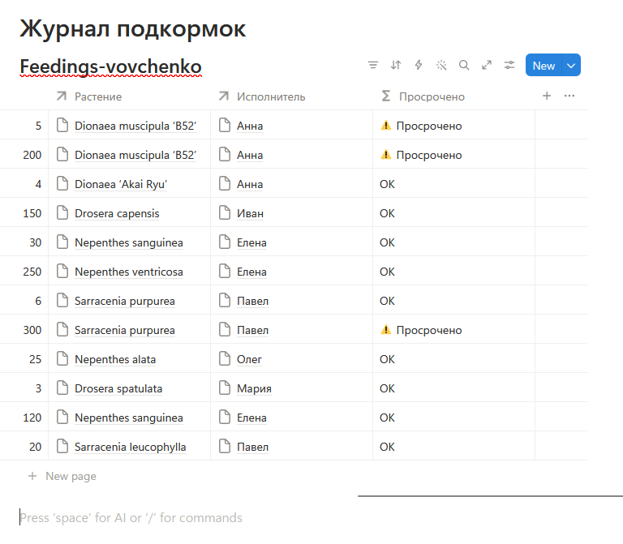

### Кнопка

Кнопка «Отметить проданным» (настройки и результат нажатия):

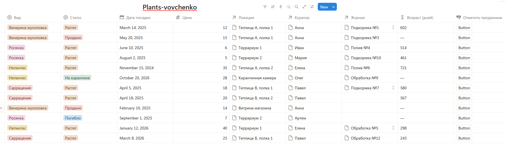

### Представления

Канбан по статусу для базы Plants:

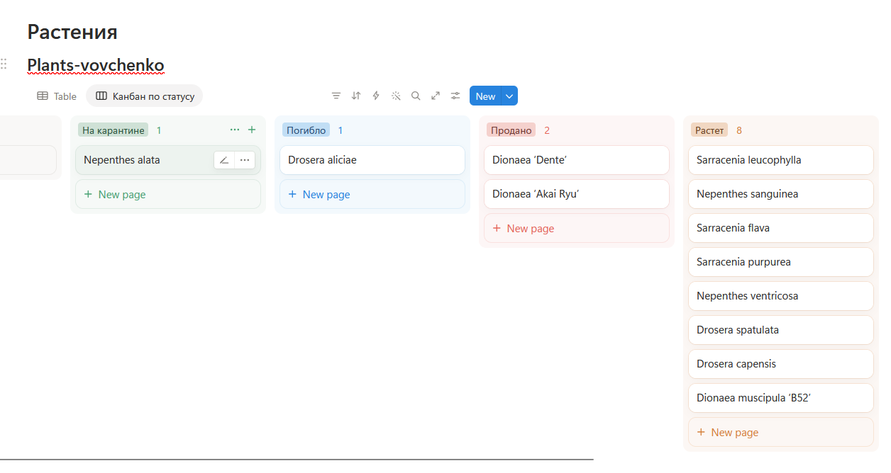

Календарь для базы Feedings:

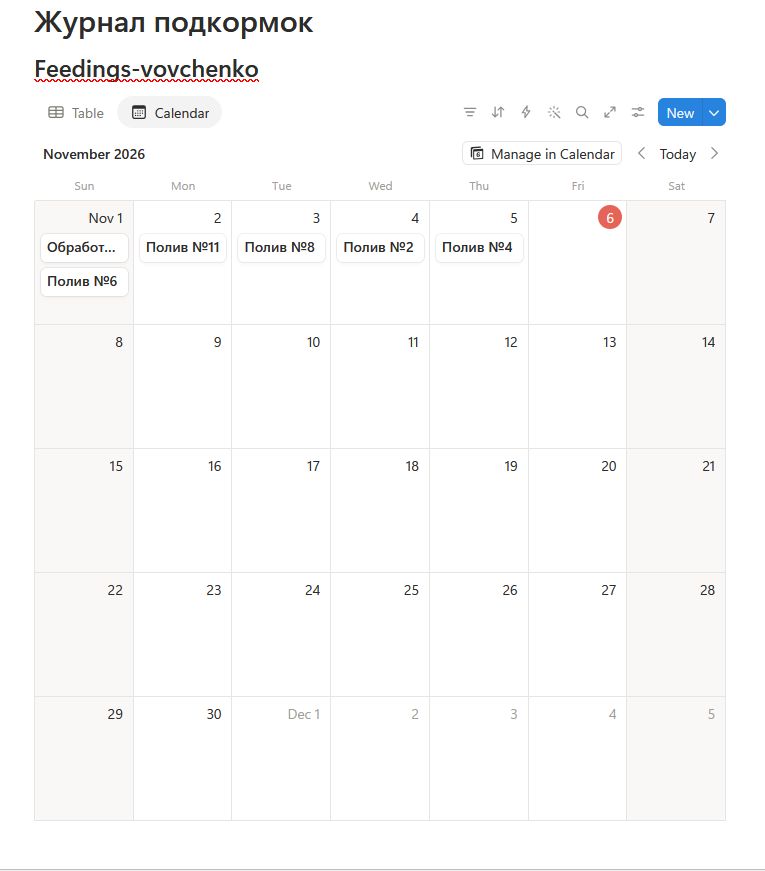

---

## 8. Выводы
Освоила работу с базами данных в Notion.
